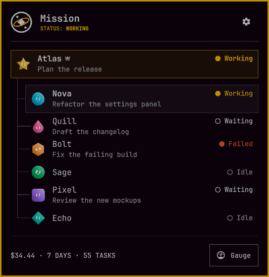
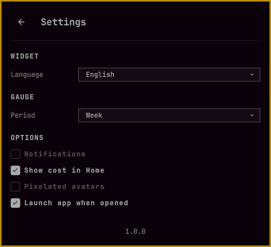
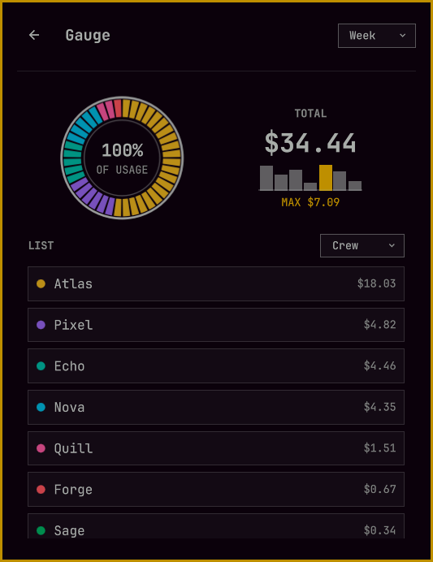
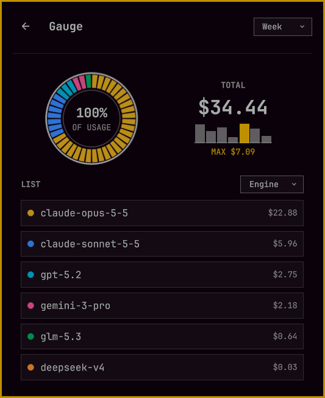
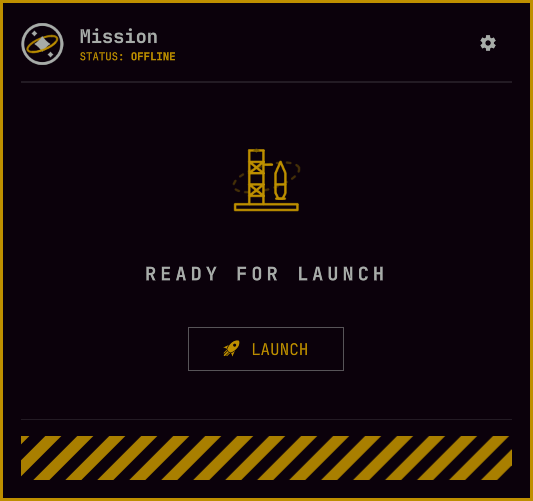
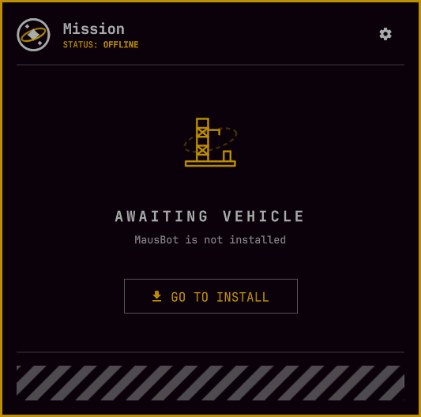

# Mission

[English](README.md) | Español



**Tu equipo de agentes de IA, su trabajo y su gasto, en la barra de Omarchy.**

Mission es un pequeño widget de barra para Omarchy para tu equipo de agentes de IA. Un clic abre el panel del equipo, donde cada bot, su estado y el trabajo que tiene entre manos están a un vistazo de distancia — y una segunda página muestra lo que gastó el equipo.

**Compatible con:** [MausBot](https://mausbot.com/) — están previstas más integraciones con otras apps de agentes.

MausBot solo crea una bandeja del sistema en Windows, así que en Linux su ventana no tiene forma de volver una vez que queda detrás de otras. Mission la trae de vuelta tras un icono de la barra.

## Funciones

- **Todo el equipo de un vistazo** — una fila por bot con su estado (trabajando, esperando, inactivo, cancelado, fallido) y la tarea que lleva, dibujado como el mapa de equipo de la propia app: el jefe en una tarjeta propia, el equipo debajo, cada bot con la mascota que le pusiste en la app.
- **El gasto del equipo** — de hoy, de los últimos 7 días o de los últimos 30, en una frase en el pie del panel y en una página Medidor con una línea de tendencia, una barra dividida y una lista por bot o por modelo.
- **Notificaciones** — cuando un bot responde a otro, una notificación de escritorio lleva la primera línea del turno, y el icono avisa de que hay algo nuevo esperando.
- **La ventana de la app, a un clic** — muestra u oculta la app de agentes con un clic central, tráela al frente o ábrela con un clic derecho.
- **Ocho idiomas** — inglés, español, alemán, francés, italiano, neerlandés, polaco y portugués, o sigue tu teclado.
- **Ligero en el sistema** — un pequeño motor en Rust sirve a todas las pantallas, en reposo gasta unos pocos MiB de RAM y CPU sin medición.

## Instalación

Requiere **Omarchy Quattro** en **x86_64** y la app **MausBot** para Linux. No hay que compilar nada: el motor viene precompilado.

```sh
omarchy plugin add https://github.com/vk2r/mission
omarchy plugin enable io.github.vk2r.mission
```

### Desinstalación

```sh
omarchy plugin disable io.github.vk2r.mission
omarchy plugin remove io.github.vk2r.mission
```

Quita el widget de la barra si tu diseño lo conservó. El plugin no crea archivos ni servicios fuera de su propia carpeta, así que no hay nada más que limpiar.

## Uso

El widget vive en la barra. El icono respira suavemente mientras el equipo trabaja.

| | |
| --- | --- |
| **Clic izquierdo** | Abre el panel del equipo; otro clic lo cierra. Abrir el panel también limpia el aviso. |
| **Clic central** | Muestra u oculta la ventana de la app de agentes. Si la app no está corriendo, la abre. |
| **Clic derecho** | Trae y enfoca la ventana, la recupera si estaba oculta, o abre la app si no está corriendo. |

Dentro del panel, **Esc** lo cierra (o vuelve una página) y **Backspace** vuelve una página.

### El panel

- **Inicio** — la página del equipo: el jefe en una tarjeta propia arriba, el equipo que coordina debajo, cada fila con su mascota, su punto de estado y su tarea actual. El pie dice lo que gastó el equipo en el período elegido — `$34.44 HOY · 71 TAREAS` — con un botón **Medidor** al lado.
- **Medidor** — el gasto del período elegido: el total con una línea de tendencia, una barra que lo divide por bot o por modelo, y la lista detrás de cada porción. El selector de período se comparte con Ajustes, así que cambiarlo en un lugar lo cambia en el otro.
- **Ajustes** — tras el engranaje en la cabecera.

### Ajustes



- **Idioma** — ocho idiomas, o automático según tu distribución de teclado y la configuración regional del sistema.
- **Período** — hoy, los últimos 7 días o los últimos 30: lo que suman el pie y el Medidor.
- **Notificaciones** — anuncia los turnos entre bots con una notificación de escritorio.
- **Mostrar costo en Inicio** — el pie añade el gasto del período junto al conteo de tareas.
- **Avatares pixelados** — dibuja las mascotas del equipo con un aspecto pixelado.
- **Abrir la aplicación al abrir** — inicia la app de agentes cuando se abre el panel y la app no está corriendo.

## Galería

| | |
| --- | --- |
|  |  |
| **Medidor** | **Medidor por modelo** |
|  |  |
| **Con la app cerrada** | **Sin la app instalada** |

## Privacidad

Mission solo lee los archivos locales de la app de agentes — con MausBot, su registro de bots, su base de datos y su registro de uso — y habla con Hyprland para colocar la ventana. No tiene acceso a la red, no escucha en ningún puerto, y nada de lo que lee sale de tu máquina.

Licencia MIT; ver [LICENSE](LICENSE).

Más detalle — cómo funciona el motor, cómo compilarlo y cómo añadir un idioma — está en [DEVELOPMENT.md](DEVELOPMENT.md) (en inglés).
