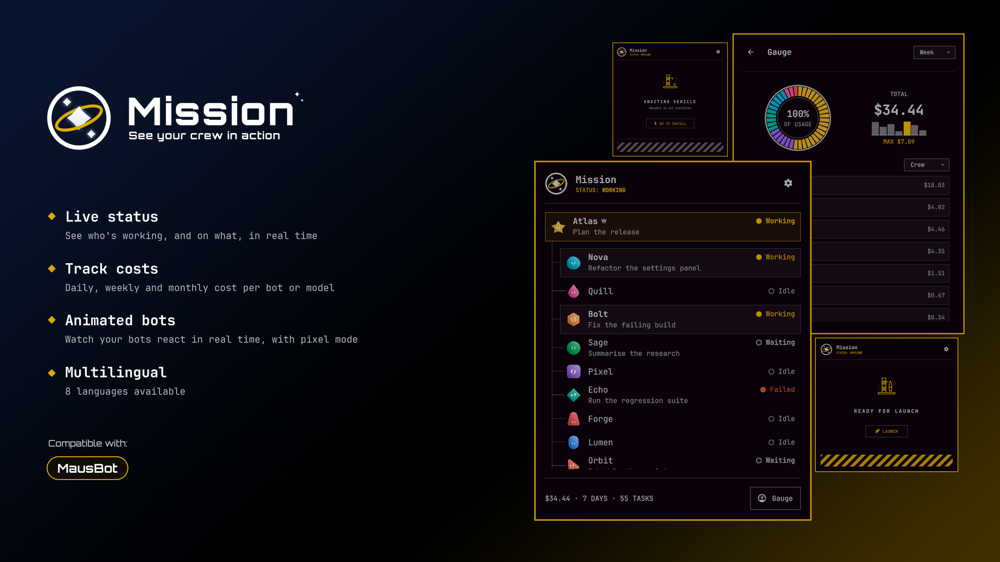
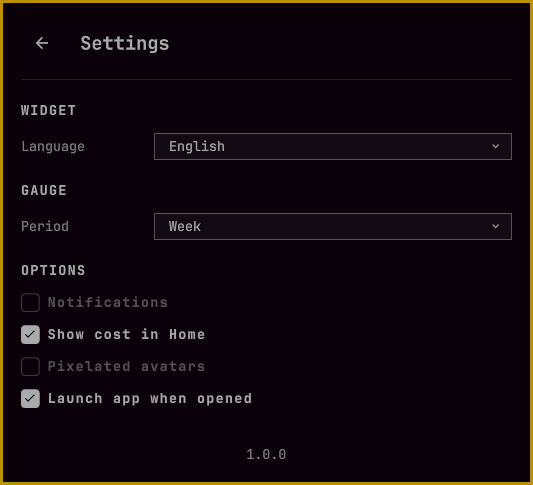
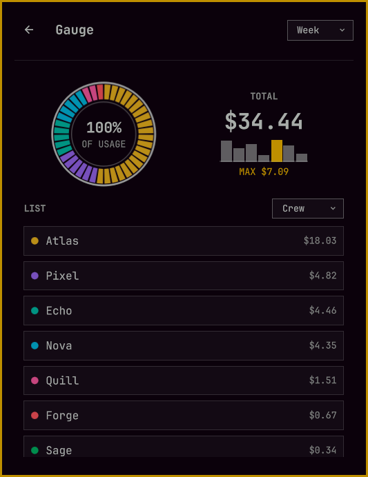
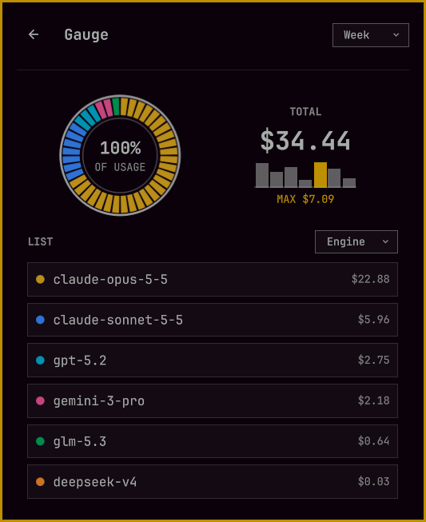
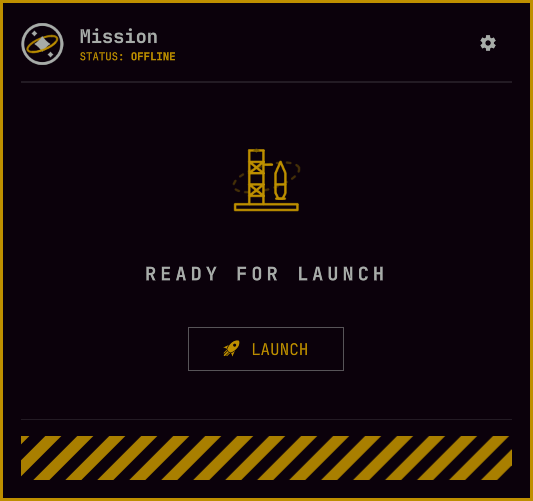
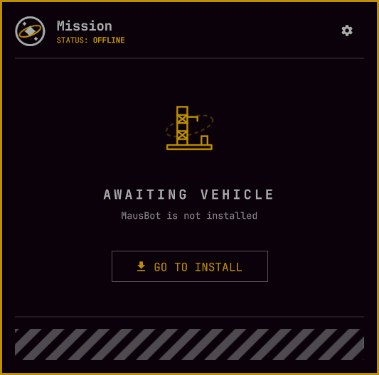

English | [Español](README.es.md)

**Your AI agent team, its work and its spend, right in the Omarchy bar.**

Mission is a small Omarchy bar widget for your team of AI agents. One click opens the team panel, where every bot, its state and the work it is on are one glance away — and a second page shows what the team spent.

**Works with:** [MausBot](https://mausbot.com/) — more integrations with other agent apps are planned.

MausBot only builds a system tray on Windows, so on Linux its window has no way back once it is behind other windows. Mission brings it back behind one bar icon.

## Features

- **The whole team at a glance** — one row per bot with its state (working, waiting, idle, cancelled, failed) and the task it is on, drawn like the app's own team map: the chief on a card of its own, the team below it, each bot wearing the mascot you gave it in the app.
- **The team's spend** — for today, the last 7 days or the last 30, in one sentence on the panel footer and on a Gauge page with a sparkline, a split bar and a list by bot or by model.
- **Notifications** — when a bot answers another bot, a desktop notification carries the first line of the turn, and the icon lets you know something new is waiting.
- **The app window, one click away** — show or hide the agent app with a middle click, raise or launch it with a right click.
- **Eight languages** — English, Spanish, German, French, Italian, Dutch, Polish and Portuguese, or follow your keyboard.
- **Light on the system** — one small Rust engine serves every screen, idles at a few MiB of RAM and no measurable CPU.

## Install

Requires **Omarchy Quattro** on **x86_64** and the **MausBot** app for Linux. Nothing needs to be compiled: the engine ships prebuilt.

```sh
omarchy plugin add https://github.com/vk2r/mission
omarchy plugin enable io.github.vk2r.mission
```

### Uninstall

```sh
omarchy plugin disable io.github.vk2r.mission
omarchy plugin remove io.github.vk2r.mission
```

Drop the widget from the bar if your layout kept it. The plugin creates no files or services outside its own folder, so nothing else needs cleaning up.

## Usage

The widget lives in the bar. The icon breathes softly while the team works.

|                  |                                                                                                           |
| ---------------- | --------------------------------------------------------------------------------------------------------- |
| **Left click**   | Opens the team panel; another click closes it. Opening the panel also clears the alert.                   |
| **Middle click** | Shows or hides the agent app's window. If the app is not running, it launches it.                         |
| **Right click**  | Raises and focuses the window, brings it back if it was hidden, or launches the app if it is not running. |

Inside the panel, **Esc** closes it (or goes back a page) and **Backspace** goes back a page.

### The panel

- **Home** — the team page: the chief on a card of its own at the top, the team it coordinates below, each row with its mascot, state dot and current task. The footer says what the team spent in the chosen period — `$34.44 TODAY · 71 TASKS` — with a **Gauge** button beside it.
- **Gauge** — the spend of the chosen period: the total with a sparkline, a bar that splits it by bot or by model, and the list behind each slice. The period dropdown is shared with Settings, so changing it in one place changes the other.
- **Settings** — behind the gear in the header.

### Settings



- **Language** — eight languages, or automatic from your keyboard layout and system locale.
- **Period** — today, the last 7 days or the last 30: what the footer and the Gauge add up.
- **Notifications** — announce turns between bots with a desktop notification.
- **Show cost in Home** — the footer adds the period's spend next to the task count.
- **Pixelated avatars** — draw the team mascots with a pixelated look.
- **Launch app when opened** — start the agent app when the panel opens and the app is not running.

## Gallery

|                               **Gauge**                               |                       **Gauge by model**                        |
| :-------------------------------------------------------------------: | :-------------------------------------------------------------: |
|                                        |                  |
|                        **With the app closed**                        |                  **Without the app installed**                  |
|  |  |

## Privacy

Mission only reads the agent app's local files — with MausBot, its roster, its database and its usage log — and talks to Hyprland to place the window. It has no network access, listens on nothing, and nothing it reads leaves your machine.

MIT licensed; see [LICENSE](LICENSE).

More detail — how the engine works, how to build it and how to add a language — is in [DEVELOPMENT.md](DEVELOPMENT.md).
