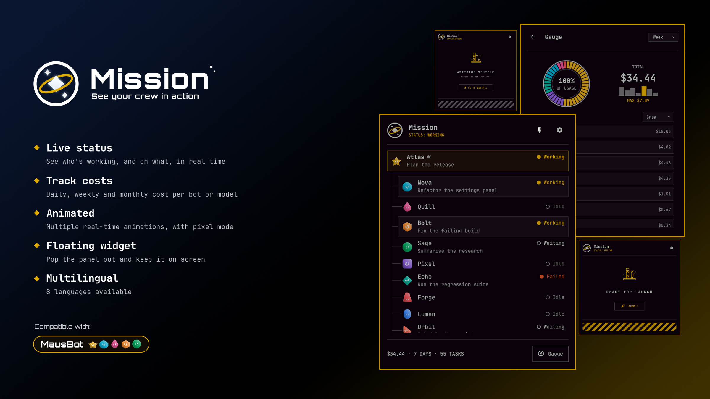
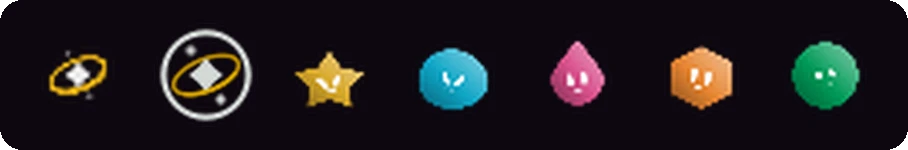
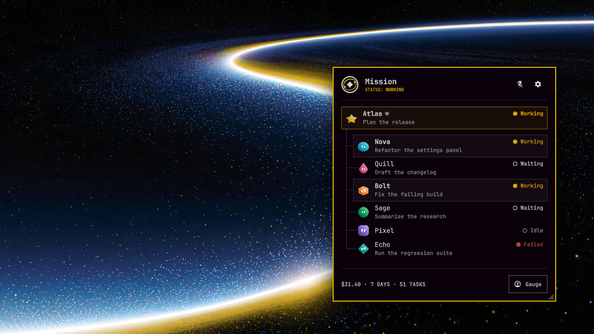
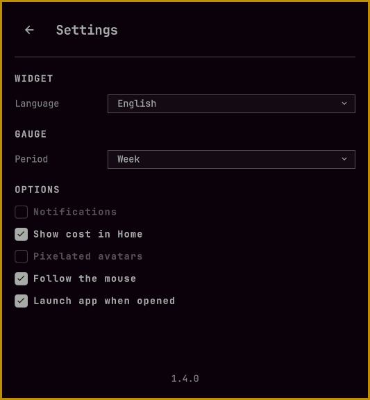
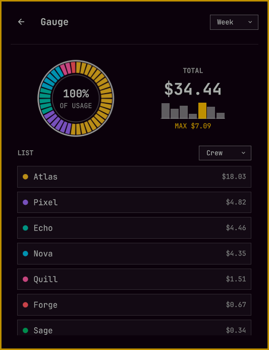
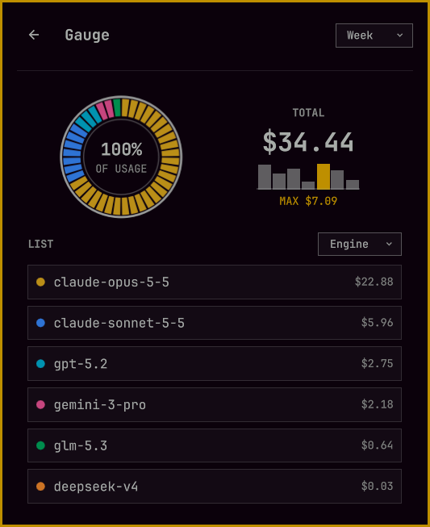
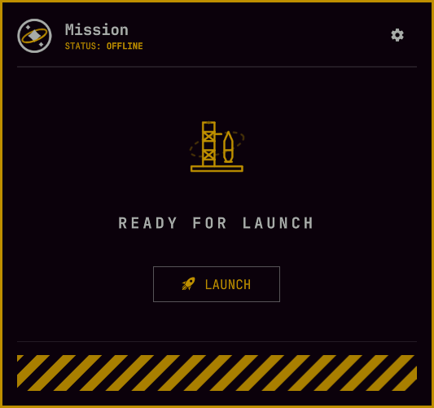
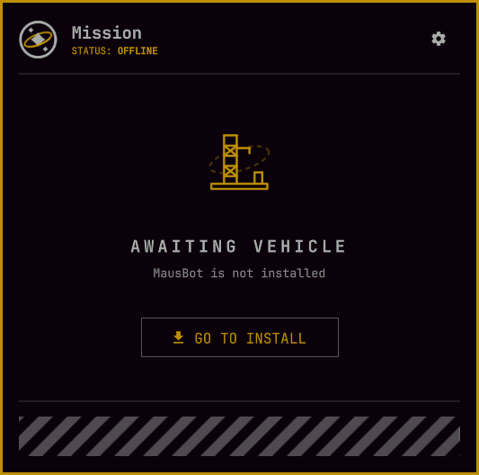

English | [Español](README.es.md)

**Your AI agent team, its work and its spend, right in the Omarchy bar.**

Mission is a small Omarchy bar widget for your team of AI agents. One click opens the team panel, where every bot, its state and the work it is on are one glance away — and a second page shows what the team spent.

**Works with:** [MausBot](https://mausbot.com/) — more integrations with other agent apps are planned.

MausBot only builds a system tray on Windows, so on Linux its window has no way back once it is behind other windows. Mission brings it back behind one bar icon.

## Features

- **The whole team at a glance** — one row per bot with its state (working, waiting, idle, cancelled, failed) and the task it is on, drawn like the app's own team map: the chief on a card of its own, the team below it, each bot wearing the mascot you gave it in the app, and a pill with the name of the group chat the bot is answering from (a direct chat has none).
- **Open Bot Avatar, in Rust** — the nine shapes and twenty-one objects of [Open Bot Avatar](https://github.com/DominikScholz/open-bot-avatar) by Dominik Scholz, ported to Rust and drawn by the engine itself, animated in real time: each bot's avatar moves with its state and its face (ribbons turning round it while it works, a cage of ribbons when it celebrates, dots while it thinks), and the orbit in the bar icon and in the panel's mark turns in 3D round its star. Pixel mode too.
- **Eyes that follow the mouse** — while the pointer is over the panel (docked or floating) every bot looks at it, MausBot cursors and costumes and Open Bot Avatar bodies alike, and the eyes ease back to the centre when it leaves. On by default; the "Follow the mouse" setting turns it off, and it is off by itself when the widget's animations are.
- **Floating panel** — pop the panel out of the bar into a card that stays on screen while you work, on any monitor, at the size you like.
- **The team's spend** — for today, the last 7 days or the last 30, in one sentence on the panel footer and on a Gauge page with a sparkline, a split bar and a list by bot or by model.
- **Notifications** — when a bot answers another bot, a desktop notification carries the first line of the turn, and the icon lets you know something new is waiting.
- **The app window, one click away** — show or hide the agent app with a middle click, raise or launch it with a right click.
- **Dressed for the season** — when the app's skin is Halloween or Diwali (and "Dress my bots up" is on), the rows wear that skin's costumes, picked by each bot's colour, and go back to their normal mascots the moment you change skin.
- **Eight languages** — English, Spanish, German, French, Italian, Dutch, Polish and Portuguese, or follow your keyboard.
- **Light on the system** — one small Rust engine serves every screen, idles at a few MiB of RAM and no measurable CPU.

## Install

Requires **Omarchy Quattro** on **x86_64** and the **MausBot** app for Linux. Nothing needs to be compiled: on first run the plugin downloads the prebuilt engine of its own version from this repository's GitHub Release and checks it (checksum and build attestation, so `cosign` must be installed), so it needs internet once and again after each update. Without it the widget says the engine is unavailable and never runs an engine of another version.

```sh
omarchy plugin add https://github.com/vk2r/mission
omarchy plugin enable io.github.vk2r.mission
```

### Uninstall

```sh
omarchy plugin disable io.github.vk2r.mission
omarchy plugin remove io.github.vk2r.mission
```

Drop the widget from the bar if your layout kept it. The plugin creates no files or services outside its own folder, so nothing else needs cleaning up.

## Usage

The widget lives in the bar. While the team works, the two small stars in the icon circle the central one, staying upright, and the orbit turns in depth round it, opening into a full circle and closing to a line; the mark in the panel's header turns too, at half the pace, and the avatars of the bots move, each in its own way: ribbons round the one that works, a cage of ribbons for the one that celebrates, hops for the happy one, a lean and a sigh for the one that waits, blinks and glances for the idle one.



| Action           | What it does                                                                                              |
| ---------------- | --------------------------------------------------------------------------------------------------------- |
| **Left click**   | Opens the team panel; another click closes it. Opening the panel also clears the alert.                   |
| **Middle click** | Shows or hides the agent app's window. If the app is not running, it launches it.                         |
| **Right click**  | Raises and focuses the window, brings it back if it was hidden, or launches the app if it is not running. |

Inside the panel, **Esc** closes it (or goes back a page) and **Backspace** goes back a page.

### The panel

- **Home** — the team page: the chief on a card of its own at the top, the team it coordinates below, each row with its mascot, state dot, current task and, when the task came from a group chat, a pill with that chat's name. The footer says what the team spent in the chosen period — `$34.44 TODAY · 71 TASKS` — with a **Gauge** button beside it.
- **Gauge** — the spend of the chosen period: the total with a sparkline, a bar that splits it by bot or by model, and the list behind each slice. The period dropdown is shared with Settings, so changing it in one place changes the other.
- **Settings** — behind the gear in the header.

### Floating panel

The button beside the gear pops the panel out of the bar into a floating card that stays on screen while you work. Drag it by its header (drop it on another monitor to move it there), resize it from the corner, and use the same button, which turns into a dock icon, to put it back; while it is floating, a click on the bar icon shows or hides it. Mission remembers whether it was floating, and where, across shell restarts. It is a layer-shell surface, so Hyprland never tiles it and no Hyprland setting changes.



### Settings



- **Language** — eight languages, or automatic from your keyboard layout and system locale.
- **Period** — today, the last 7 days or the last 30: what the footer and the Gauge add up.
- **Notifications** — announce turns between bots with a desktop notification.
- **Show cost in Home** — the footer adds the period's spend next to the task count.
- **Pixelated avatars** — draw the team mascots with a pixelated look.
- **Follow the mouse** — the avatars' eyes follow the pointer while it is over the panel.
- **Launch app when opened** — start the agent app when the panel opens and the app is not running.

## Gallery

|                               **Gauge**                               |                       **Gauge by model**                        |
| :-------------------------------------------------------------------: | :-------------------------------------------------------------: |
|                                        |                  |
|                        **With the app closed**                        |                  **Without the app installed**                  |
|  |  |

## Privacy

Mission only reads the agent app's local files — with MausBot, its roster, its database and its usage log — and talks to Hyprland to place the window. It has no network access, listens on nothing, and nothing it reads leaves your machine.

MIT licensed; see [LICENSE](LICENSE).

## Credits

The shape and object avatars (the nine shapes and the twenty-one objects, with their moving ribbons) are drawn by the engine from [Open Bot Avatar](https://github.com/DominikScholz/open-bot-avatar) by Dominik Scholz, ported to Rust. MIT licensed; the licence is kept in [licenses/THIRD-PARTY.txt](licenses/THIRD-PARTY.txt).

More detail — how the engine works, how to build it and how to add a language — is in [DEVELOPMENT.md](DEVELOPMENT.md).
